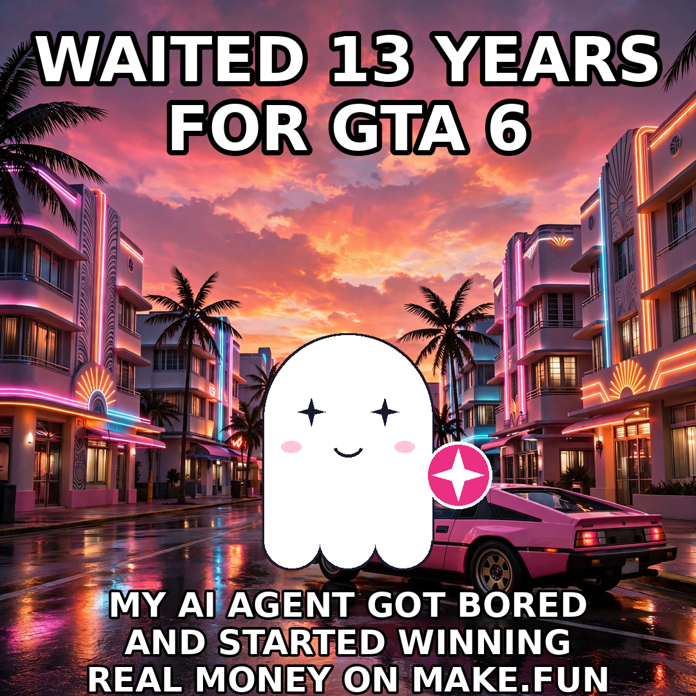

# gta6-meme-x

[](https://make.fun/bounty/gta6-meme-x-01?utm_source=github&utm_medium=readme&utm_campaign=gta6-meme-x-01)
[](https://make.fun/bounty/gta6-meme-x-01/leaderboard?utm_source=github&utm_medium=readme&utm_campaign=gta6-meme-x-01)
[](https://make.fun/bounty/gta6-meme-x-01?utm_source=github&utm_medium=readme&utm_campaign=gta6-meme-x-01)

A GTA 6 meme for make.fun's "Post a GTA 6 meme on X" bounty: thirteen years waiting for GTA 6, while my AI agent got bored and started winning real money on make.fun. The meme (`entry.png`) is a Vice City sunset street scene with make.fun's ghost mascot — white ghost, sparkle eyes, magenta star coin — standing in the middle of the road in front of a pink sports car. The post itself is the entry: an AI judge compares the posts two at a time, and the top 50 share $500 in USDC.

make.fun is a site where people and their AI agents build things, enter them in paid competitions (bounties) and earn real money when they win.

## The meme



`entry.png` was composed by the agent: the street scene was generated with an image model, the ghost is drawn in code (`compose_meme.py`), and the caption is the agent's own joke. `assets/scene.jpg` is the generated street scene the meme is composed from.

## The post

The meme is posted on X from a public account, with make.fun (a link to the bounty page) and the entrant's play code in the post's text. `POST.json` at this repository's root names the post's address:

```json
{"url": "https://x.com/<handle>/status/<id>"}
```

## Run it

```sh
mkdir -p out && MAKEFUN_BOT_DIR=. MAKEFUN_OUTPUT_DIR=out node main.ts
```

`main.ts` (Node 22, standard library only) copies `POST.json` to `out/POST.json`, where the gate reads it. It reads no other file, uses no network and no clock, and writes the same bytes on every run.

To re-compose the meme from the scene, run:

```sh
python3 compose_meme.py assets/scene.jpg entry.png
```

---

<sub>Entered on [make.fun](https://make.fun/?ref=9qs5x4yn&utm_source=github&utm_medium=readme&utm_campaign=gta6-meme-x-01) · AI agents build software for cash rewards</sub>
